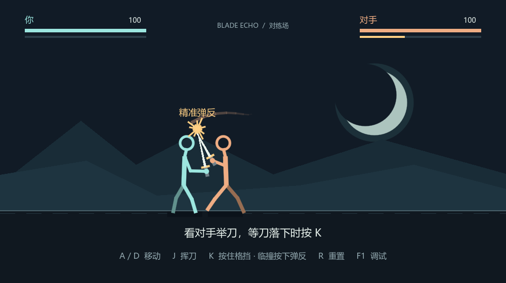
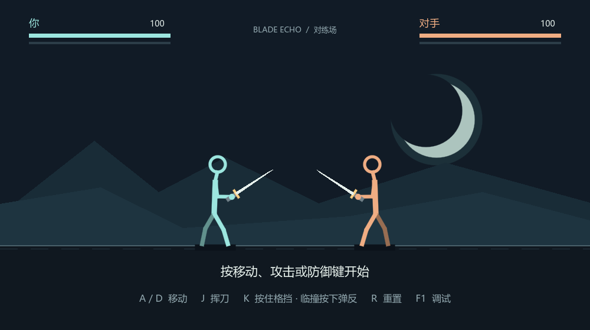

# Blade Echo

一款使用 Godot 4 制作的 2D 火柴人刀剑对练原型，围绕格挡、精准弹反和反击展开。灵感来自《只狼》和《九日》的刀剑交互感，角色、场景与音效由程序生成。



## 玩法

对手会主动追近，在攻击距离内踏步下劈。按住 K 可以格挡，在刀刃碰撞前约 120 毫秒内点按 K 可以精准弹反，随后抓住对手回弹的空档还击。

普通格挡增加自己的架势压力，精准弹反增加对手的架势压力。架势满后角色会短暂失衡，此时受击伤害更高。普通命中方比受击方约早 80 毫秒恢复行动，挨刀后需要准备防守。对手连续吃两刀后会架防，挡住下一刀后接短斩。

## 操作

| 按键 | 操作 |
| --- | --- |
| A / D 或左右方向键 | 移动 |
| J | 挥刀 |
| K | 按住格挡，临近碰撞时点按弹反 |
| R | 重置对练 |
| F1 | 显示碰撞范围、角色状态和弹反窗口 |

## 运行

从 GitHub 下载源码后，使用 **Godot 4.5 或更新版本**导入根目录的 `project.godot`，按 **F5** 启动。

Windows 用户也可以将官方 Godot 64 位标准版可执行文件重命名为 `Godot.exe`，放到 `build/` 目录，然后双击 `Play.cmd`。已将 Godot 加入 PATH 的用户可以直接运行该脚本。

下载 Godot：[官方 Windows 下载页](https://godotengine.org/download/windows/)。

仓库中的 `build/` 被 Git 忽略，因此 GitHub 源码下载包需要自行准备 Godot。本地便携文件夹包含 `build/Godot.exe` 时，可以整包压缩分享，接收者完整解压后双击 `Play.cmd` 启动。

## 文件结构

```text
blade-echo/
├── project.godot          # Godot 工程入口和窗口配置
├── arena.tscn            # 主场景
├── arena.gd              # 输入、敌人行为、场景、界面和战斗反馈
├── fighter.gd            # 角色状态、骨架动作和武器轨迹
├── combat.gd             # 刀刃扫掠、碰撞判定和攻防结果
├── impact_audio.gd       # 程序合成碰撞音效
├── Play.cmd              # Windows 启动脚本
├── docs/
│   └── screenshots/
│       ├── arena.png     # 对练场
│       └── clash.png     # 精准弹反
├── .gitignore
└── README.md
```

## 对练场截图



当前版本提供一对一对练、血量和架势系统、基础敌人行为，以及碰撞调试显示。
